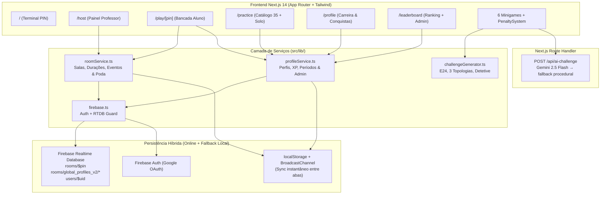

# Arquitetura Técnica — Arena Eletrônica SENAI (V2.0)

Este documento descreve a arquitetura interna, os contratos de dados, as estratégias de sincronização, as regras de negócio e as convenções técnicas do projeto **Arena Eletrônica SENAI**. Serve como referência para manutenção, evolução e ambientação de novos desenvolvedores ou agentes.

---

## 1. Visão Geral da Arquitetura

A aplicação é um monólito **Next.js 14 (App Router)** majoritariamente client-side (`"use client"` nas páginas interativas), com uma única rota de API server-side (`/api/ai-challenge`) para integração segura com o Google Gemini.



---

## 2. Persistência Híbrida (Firebase RTDB + Fallback Local)

O projeto foi desenhado para **nunca travar em laboratório escolar** (mesmo sob firewall, latência alta ou ausência de credenciais Firebase):

1. **Detecção segura (`src/lib/firebase.ts`):**
   - `isFirebaseAuthConfigured`: `true` quando `NEXT_PUBLIC_FIREBASE_API_KEY` e `NEXT_PUBLIC_FIREBASE_PROJECT_ID` estão definidos.
   - `isFirebaseConfigured`: exige adicionalmente `databaseURL` iniciando com `https://`.
   - Todas as chamadas ao Firebase usam wrappers com timeout (`withDbTimeout` em `roomService.ts` e `safeFirebaseCall` em `profileService.ts`) e sanitização contra `undefined` (`sanitizeForFirebase` via `JSON.parse(JSON.stringify(...))`).
2. **Fallback Local Multi-Abas:**
   - Salas são gravadas em `localStorage` com prefixo `senai_arena_room_<PIN>` e sincronizadas instantaneamente entre abas via `BroadcastChannel("senai_arena_sync_channel")`, evento `storage` e polling leve de `1000ms`.
   - Perfis locais são gravados em `senai_arena_v2_users_db` com UID ativo em `senai_arena_v2_active_uid` e evento customizado `senai_profile_updated`.

### Mapa de Caminhos no Firebase Realtime Database

Definido para compatibilidade com [`database.rules.json`](./database.rules.json) (que libera leitura/escrita em `rooms/$pin` e `users/$uid`):

| Caminho RTDB | Uso |
| :--- | :--- |
| `rooms/{pin}` | Estado completo da sala (`GameRoom`): `status`, `minigameId`, `durationSec`, `startedAt`, `endsAt`, `players`, `events` |
| `rooms/{pin}/players/{playerId}` | Estado individual de pontuação/combo na rodada (`PlayerState`) |
| `rooms/{pin}/events/{eventId}` | Telemetria ao vivo da bancada (`RoomEvent`) |
| `rooms/global_profiles_v2/users/{uid}` | Espelho principal de perfis (compatível mesmo com regras V1 que só liberam `rooms/*`) |
| `rooms/global_profiles_v2/meta` | Metadados do ranking global (`LeaderboardMeta`: `periodResetAt`, `seasonNumber`, `updatedAt`) |
| `users/{uid}` | Cópia paralela do perfil para compatibilidade com regras V2 |

> **Atenção:** `writeRemoteProfileToFirebase` grava em **ambos** os caminhos (`rooms/global_profiles_v2/users/{uid}` e `users/{uid}`) via `Promise.allSettled`, e `fetchRemoteProfileFromFirebase` / `subscribeToGlobalLeaderboard` reconciliam ambos usando `pickPreferredProfile` (priorizando `adminOverrideAt`, depois maior `totalXp`, depois `updatedAt`).

---

## 3. Fluxo de Salas ao Vivo e Modos de Duração (`roomService.ts`)

### Ciclo de Vida da Sala
`Configuração (!room)` → `LOBBY` → `PLAYING` → `FINISHED` → (reaproveita mesmo PIN via `switchMinigameInRoom`) → `LOBBY`.

### Modos de Duração (`SESSION_DURATION_OPTIONS`)
Centralizados em `src/lib/roomService.ts` e compartilhados por `/host` e `/play/[pin]`:

| `seconds` | `label` | `shortLabel` | `tier` |
| :---: | :---: | :---: | :---: |
| `90` | `1m30` | `1m30 (90s)` | `standard` |
| `120` | `2 min` | `2m (120s)` | `standard` |
| `180` | `3 min` | `3m (180s)` | `standard` |
| `240` | `4 min` | `4m (240s)` | `standard` |
| `300` | `5 min` | `5m (300s)` | `extended` |
| `420` | `7 min` | `7m (420s)` | `extended` |
| `600` | `10 min` | `10m (600s)` | `extended` |

Formatadores auxiliares: `formatDurationCompact(sec)` (ex.: `10 min`, `1m30`) e `formatDurationLabel(sec)` (ex.: `10 min (600s)`).

### Troca de Tempo no Mesmo PIN
- **No Lobby (`/host`):** `handleUpdateLobbyDuration(sec)` atualiza o estado local imediatamente e persiste via `updateRoomDuration(pin, sec)` (só altera se `status === "LOBBY"`). A tela do aluno (`/play/[pin]`) reflete a mudança ao vivo no badge `Duração da rodada`.
- **Ao Iniciar:** `startRoomGame(pin, room.durationSec)` recebe a duração explícita para evitar condições de corrida entre `updateRoomDuration` e o cálculo de `endsAt = now + activeDuration * 1000`.
- **No Pódio Final (`FINISHED`):** o seletor *"Tempo da próxima rodada"* altera apenas o estado local `durationSec` — preservando `room.durationSec` no cabeçalho do relatório encerrado — e injeta o novo tempo em `switchMinigameInRoom(pin, gameId, nextDuration, true)` tanto em *"Repetir Módulo"* quanto nos cards de próximo módulo.

### Estabilidade para Rodadas Longas (5 a 10 minutos)
Para suportar turmas inteiras jogando continuamente por 10 minutos sem degradação de rede ou memória:
1. **Leitura granular no Firebase (`recordPlayerAction`):** em vez de baixar `rooms/{pin}` inteiro a cada clique, realiza `Promise.all` apenas nas 3 folhas `status`, `startedAt` e `players/{playerId}` (~225 bytes por jogada).
2. **Limite local de eventos:** `trimRoomEvents` mantém no máximo `24` eventos mais recentes no `localStorage`.
3. **Poda de eventos liderada pelo Host (`pruneRoomEvents`):** `host/page.tsx` monitora `room.events` durante `PLAYING`; ao passar de `30` registros, remove em lote (via `update` com `null`) os excedentes além dos `20` mais recentes. Apenas o host faz a poda, evitando colisões entre alunos.
4. **Timers e bots estáveis:** os `useEffect` de cronômetro (`/host` e `/play/[pin]`) dependem apenas de `[roomPin, roomStatus, roomEndsAt]` com guarda booleana `finishTriggered` contra disparo repetido de `finishRoomGame`. Os bots simulados dependem apenas de `[roomPin, roomStatus, botIdsKey]`.

---

## 4. Minigames, Desafio Industrial (OS), Geração Procedural e Penalidades

### Contrato Comum dos 6 Minigames
Todos os 6 componentes em `src/components/minigames/` (5 Fundamentos + 1 Desafio Industrial `industrial_repair` em `track: "fundamentos" | "industrial"`) recebem uma única prop de callback:
```ts
onScoreAction: (
  deltaScore: number,
  isHit: boolean,
  actionMessage: string,
  newLevel?: number
) => void;
```
Isso permite que o mesmo componente rode de forma idêntica em `/play/[pin]` (sincronizado em sala, com largura expandida `max-w-5xl` no módulo industrial) e em `/practice` (treino solo, com auto-save calibrado em `targetActions = 3` para `industrial_repair`, `6` para `match` e `5` para os demais).

### Sistema de Penalidades (`PenaltySystem.tsx`)
O hook `usePenaltySystem(onScoreAction, onAutoclickDetected?)` fornece:
- **Penalidade progressiva por erros consecutivos:**
  - `1º erro`: `-40 pts`, bloqueio `2.500 ms`
  - `2º erro`: `-70 pts`, bloqueio `4.000 ms`
  - `3º+ erro`: `-110 pts`, bloqueio `6.000 ms`
  - Qualquer acerto via `registerHit(...)` zera `consecutiveErrors`.
- **Diferenciação de Segurança (`severity?: "error" | "safety"`):** `triggerErrorPenalty` aceita o 5º parâmetro opcional `severity`. Quando `"safety"`, `lockReason` assume `"safety"` e o `PenaltyBanner` renderiza o selo âmbar **`ALERTA DE SEGURANÇA NA SIMULAÇÃO`** (ex.: tentativa de soldagem com placa energizada ou prática destrutiva na bancada).
- **Proteção anti-autoclique:** `handleContainerPointerDown` (ligado a `onPointerDownCapture`) monitora janela de `480 ms`; ao detectar `>= 4` cliques, bloqueia a bancada por `5.000 ms` e aplica `-90 pts` (com cooldown de `1.800 ms` na dedução para não drenar pontos em rajada).

### Desafio Industrial — Estação de Reparo de PCI (`industrialChallengesData.ts` + `minigames/industrial/`)
- **Banco curado (`src/data/industrialChallengesData.ts`):** 4 Ordens de Serviço em `pt-BR` (`REPAIR_CASES`: `OS-SOL-01` a `OS-SOL-04`), com fila embaralhada sem repetição consecutiva (`pickNextShuffledCase`) para sustentar sessões de 5, 7 e 10 minutos.
- **Realismo controlado (`public/images/industrial/*.jpg`):** 3 fundos fotográficos genéricos sem texto/marcas (`workbench-esd.jpg`, `pcb-pth-closeup.jpg`, `pcb-smd-closeup.jpg`) combinados a overlays HTML/SVG nítidos que renderizam componentes PTH/SMD, juntas de solda e defeitos físicos.
- **Infraestrutura compartilhada (`src/components/minigames/industrial/`):**
  - `IndustrialOSHeader.tsx`: abertura padronizada de OS (código, setor, sintoma, impacto, condição de trabalho e etapas).
  - `IndustrialClosingReport.tsx`: devolutiva nas 5 dimensões (*Segurança*, *Evidência*, *Decisão Técnica*, *Qualidade*, *Tempo*), erro mais comum, capacidade técnica e próximo passo seguro.
  - `IndustrialBoardViewport.tsx`: viewport de inspeção de PCI com zoom (`1x`–`2.5x`), pan, lupa óptica virtual, hotspots acessíveis por teclado e `BoardComponentGraphic` para variantes visuais de defeito e estado corrigido (Antes/Depois).

### Motores de Geração (`challengeGenerator.ts` + `/api/ai-challenge`)
- **Catálogo (`electronicsData.ts`):** `35` componentes em `ELECTRONIC_COMPONENTS` (`7` `passivo`, `10` `semicondutor`, `10` `protecao_energia`, `8` `digital_logica`), todos com vetor SVG próprio em `ElectronicSymbolSVG.tsx`.
- **Resistor E12/E24:** `21` mantissas × `6` multiplicadores (`x1 Ω` até `x100 kΩ`) = `126` valores comerciais com cenários dinâmicos de aplicação prática e Lei de Ohm.
- **Radar do Circuito:** `3` topologias completas em `RADAR_TOPOLOGIES` (`fonte_linear_sensor`, `automacao_logica_digital`, `potencia_controle_industrial`), 12 nós cada, com rotação automática a cada 3 acertos e 3 formatos de pergunta (`symptom`, `function`, `designator`).
- **Detetive / Diagnóstico por Pistas:** combina pistas procedurais (`generateProceduralDetectiveCase`) com chamadas alternadas ao endpoint `POST /api/ai-challenge` (usa `gemini-2.5-flash` quando `GEMINI_API_KEY` está configurada e faz fallback silencioso para o motor procedural caso contrário).

---

## 5. Progressão, XP, Conquistas e Ranking (`achievementsData.ts` & `profileService.ts`)

### Fórmula de XP por Partida
Executada em `recordCompletedMatch` (exige `hits > 0` e `score > 0`):
```ts
const baseXp = Math.max(15, Math.round(Math.max(0, score) * 0.5) + hits * 8);
const accuracyBonus = accuracyPct >= 90 && hits >= 5 ? 45 : 0;
let totalXpEarned = baseXp + accuracyBonus; // + xpReward de conquistas desbloqueadas na partida
```
- **Proteção contra duplicação:** salas usam `roundKey = room_${pin}_${minigameId}_${startedAt}`, verificado em memória (`inFlightRoundKeys`), em `localStorage` (`senai_arena_v2_processed_rounds`) e em `profile.recentMatches`.
- **Treino Solo (`/practice`):** cada jogatina faz auto-save a cada `5` ações (`QUESTIONS_PER_SOLO_ROUND = 5`, ou `6` pares no `match`) e também salva ao trocar de minigame/aba ou clicar em *Finalizar & Salvar XP*.

### Curva de Níveis e Patentes (`achievementsData.ts`)
- **100 Níveis (`SENAI_RANK_TIERS`):** Nível `1` = `0 XP` até Nível `100` = `1.000.000 XP`, com saltos estritamente crescentes (`deltaXpRequired` monotônico).
- **21 Patentes Técnicas (`SENAI_PATENTS`):** 1 patente a cada 5 níveis (NV 1–4, 5–9, ..., 95–99 e NV 100 Lendário), distribuídas em 8 divisões (`bronze`, `prata`, `ouro`, `platina`, `esmeralda`, `diamante`, `mestre`, `lendario`).
- **58 Conquistas (`ACHIEVEMENTS_CATALOG`):** avaliadas automaticamente ao fim de cada partida em loop multi-pass (`evaluateAndSyncProfileAchievements`: início, precisão, combo, especialistas nas 6 bancadas, manobras/inovação, volume e marcos de carreira).

### Ranking Multi-Período e Modo Admin
- **Períodos (`getProfilePeriodStats`):**
  - `weekly`: reinicia toda segunda-feira às `00:00` (`weekKey: W_YYYY-MM-DD`) ou no `periodResetAt` manual.
  - `monthly`: reinicia dia 1º de cada mês (`monthKey: M_YYYY-MM`) ou no `periodResetAt` manual.
  - `all`: acumulado histórico (`totalXp`).
- **Modo Admin (`/leaderboard`):** destravado via `verifyAdminPin` (validado no servidor pelo endpoint `POST /api/admin-auth` contra `process.env.ADMIN_PIN`, persistido na sessão via `sessionStorage`). Permite iniciar nova temporada (`adminTriggerPeriodReset`), ajustar/definir XP (`adminAdjustUserXp` com `adminOverrideAt`) ou excluir perfis (`adminDeleteUserProfile`).

---

## 6. Identidade Visual e Convenções de Código

- **Tema Industrial Escuro SENAI:**
  - Fundo base: `#111317` · Superfície/Cards: `#181B20` · Visores/Inputs: `#0C0E12` · Bordas: `#242933` / `#2A303C`
  - Primária institucional: Azul SENAI `#0047B6` / `#0057E0`
  - Destaque técnico / telemetria: Âmbar `#F59E0B` (`amber-400`/`amber-500`), Ciano `#38BDF8`, Esmeralda `#34D399` (acerto), Vermelho `#EF4444` (curto/disjuntor)
  - Fontes: `Inter` (`font-sans`) e `JetBrains Mono` (`font-mono`) via `next/font/google`
- **Idioma:** toda a interface, mensagens de telemetria, logs de eventos e documentação são em **Português (pt-BR)**.
- **Tipagem e Build:** TypeScript em modo `strict: true` com alias `@/*` → `./src/*`. Sempre validar alterações com `npx tsc --noEmit` e `npm run build` (no Windows PowerShell restrito: `npx.cmd tsc --noEmit` e `npm.cmd run build`).
- **Espelhamento do Documento Pedagógico:** `INTENCIONALIDADE_PEDAGOGICA.html` (raiz) e `public/intencionalidade-pedagogica.html` (servido no `<Footer />`) devem ser mantidos idênticos sempre que houver atualização pedagógica.
