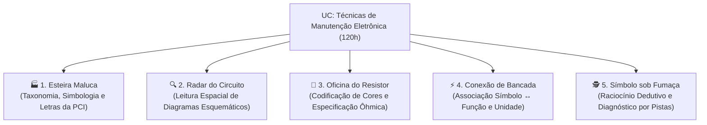

# Documento de Intencionalidade Pedagógica — Arena Eletrônica SENAI

**Autor / Docente Responsável:** [Gabriel Piske](https://piske.online/)  
**Unidade:** SENAI/SC — Timbó  
**Curso:** Aprendizagem Industrial de Eletrônico de Manutenção Industrial (Presencial — 860h)  
**Cód. CONAP:** 488 — Eletricista de Manutenção Eletroeletrônica | **CBO:** 9511-05  
**Unidade Curricular Foco:** Técnicas de Manutenção Eletrônica (Módulo Específico II — 120h: 50h Teoria / 70h Vivência Prática)  

---

## 1. Contextualização e Justificativa Pedagógica

Na **Metodologia SENAI de Educação Profissional (MSEP)**, a prática pedagógica é compreendida como um conjunto integrado de ações didático-pedagógicas que articulam **capacidades técnicas, básicas e socioemocionais** a situações reais e desafiadoras do mundo do trabalho.

Durante a Unidade Curricular de **Técnicas de Manutenção Eletrônica (120h)**, o jovem aprendiz (18 a 24 anos) precisa transitar rapidamente entre a documentação técnica (diagramas esquemáticos, listas de materiais, *datasheets* e simbologias normatizadas) e a intervenção física na placa de circuito impresso (inspeção visual, medição com multímetro, soldagem e substituição de componentes PTH e SMD).

A plataforma **Arena Eletrônica SENAI** foi projetada como um **Recurso Didático Digital Gamificado** que atua na **automatização cognitiva do reconhecimento de simbologias, grandezas e funções básicas dos componentes**. Quando o aluno reconhece instantaneamente um símbolo esquemático, sua letra designadora na PCI (`R`, `C`, `L`, `D`, `Q`, `F`, `U`, `GND`) e sua função primordial, ele reduz a carga cognitiva durante a prática de bancada, diminuindo erros operacionais, curtos-circuitos acidentais e danos a instrumentos de medição.

---

## 2. Alinhamento com o Perfil Profissional de Conclusão (Anexo I do Projeto de Curso)

A plataforma sustenta diretamente o alcance da **Competência Geral do Curso**:
> *"Atuar nos processos de montagem e manutenção dos circuitos eletrônicos de baixa complexidade, considerando a legislação, normas, padrões e requisitos técnicos de qualidade, saúde, segurança e de meio ambiente."*

| Função / Subfunção (Anexo I) | Padrões de Desempenho Atendidos pela Plataforma |
| :--- | :--- |
| **Função 1 — Subfunção: Montar circuitos eletrônicos de baixa complexidade** | • *Considerando o diagrama do circuito eletrônico;* • *Considerando as especificações técnicas dos componentes e insumos contidas em manuais e catálogos do fabricante.* |
| **Função 2 — Subfunção: Manter sistemas eletrônicos** | • *Considerando o projeto e documentações técnicas dos sistemas eletrônicos;* • *Considerando os requisitos da demanda e histórico sobre o funcionamento do sistema eletrônico;* • *Considerando os procedimentos técnicos de manutenção e proteção dos sistemas eletrônicos.* |

---

## 3. Intencionalidade Pedagógica da Arquitetura da Plataforma

Cada tela e mecanismo do sistema foi desenhado com um propósito didático claro dentro do ambiente escolar (Sala de Aula, Laboratório de Informática e Laboratório de Eletrônica):

### 3.1 Acesso Instantâneo por PIN e QR Code (`/host` e `/play/[pin]`)
* **Intencionalidade Pedagógica:** Eliminar tempos mortos de aula (cadastros longos, senhas esquecidas ou instalações de softwares pesados) e promover **engajamento coletivo imediato**.
* **Conexão com o Projeto de Curso:** Atende aos critérios de *gestão do tempo*, *organização do ambiente de aprendizagem* e uso de *Tecnologias da Informação e Comunicação (TIC)* previstas na matriz curricular.

### 3.2 Painel do Professor com Corrida de Ranking ao Vivo e Exportação CSV (`/host`)
* **Intencionalidade Pedagógica:** Transformar a revisão teórica em uma **Avaliação Formativa e Diagnóstica em Tempo Real**. Enquanto o telão projeta o desempenho da turma, o docente visualiza instantaneamente o ritmo de acertos, os "curtos-circuitos" (erros conceituais) e o nível de domínio da turma. Ao final, a exportação do relatório em `.CSV` fornece **evidências concretas de aprendizagem** para registro docente e replanejamento pedagógico.
* **Flexibilidade Didática (Execução Isolada):** O professor pode rodar **qualquer um dos 5 minigames isoladamente** (em blocos rápidos de 2 a 3 minutos no início ou fechamento da aula) conforme o tópico trabalhado no dia, ou alternar entre minigames na mesma sala mantendo o mesmo PIN.

### 3.3 Catálogo Visual de Simbologia e Bancada Solo (`/practice`)
* **Intencionalidade Pedagógica:** Promover a **Aprendizagem Ativa, Autogestão e Acessibilidade Pedagógica**. Antes ou depois da competição ao vivo, o estudante pode consultar o catálogo interativo dos 20 componentes essenciais (filtrados por *Passivos*, *Semicondutores* e *Proteção & Energia*) e treinar individualmente no seu próprio ritmo, respeitando as singularidades de cada aprendiz.

---

## 4. Intencionalidade Pedagógica Detalhada dos 5 Minigames

Diferente de quizzes convencionais de múltipla escolha que estimulam apenas a memorização passiva, cada um dos **5 Minigames** propõe uma **mecânica cognitiva e psicomotora distinta**, diretamente vinculada às **Capacidades Técnicas** e aos **Conhecimentos** da Unidade Curricular **Técnicas de Manutenção Eletrônica** (Anexo II):

---

### 🏭 Minigame 1: "Esteira Maluca de Componentes" (`ConveyorGame`)

* **Dinâmica do Desafio:** Símbolos eletrônicos deslocam-se sobre uma esteira industrial com velocidade progressiva. O aluno precisa tomar decisões rápidas para direcionar cada componente ao coletor correto — alternando entre a classificação por **Família Tecnológica** (*Passivos*, *Semicondutores*, *Proteção & Energia*) e a identificação direta de **Nome + Letra Designadora na PCI** (`R`, `C`, `L`, `D`, `Q`, `F`, etc.).
* **Intencionalidade Pedagógica (Domínio Cognitivo e Psicomotor):**
  * Simula o ritmo dinâmico da indústria eletroeletrônica (triagem de insumos, preparação de *kits* de montagem/manutenção e conferência de *Bill of Materials — BOM*).
  * Desenvolve o **reconhecimento visual imediato (automatismo)** do símbolo normatizado e sua respectiva letra na serigrafia da placa, evitando trocas acidentais de componentes.
  * O feedback imediato a cada acerto ou "curto-circuito" exibe a função e a unidade do componente, transformando o erro em oportunidade instantânea de aprendizagem.
* **Capacidades Técnicas Mobilizadas (Anexo II — Técnicas de Manutenção Eletrônica):**
  * **CT2:** *Identificar componentes eletrônicos;*
  * **CT3:** *Avaliar as características dos componentes eletrônicos;*
  * **CT6:** *Identificar a simbologia de componentes eletrônicos.*
* **Conhecimentos Associados:**
  * *1.1 Características (PTH e SMD);*
  * *2.1 Interpretação de esquemas eletrônicos;*
  * *6.2 Lista de Materiais.*

---

### 🔍 Minigame 2: "Radar do Circuito" (`CircuitRadarGame`)

* **Dinâmica do Desafio:** O aluno não vê o símbolo isolado, mas sim inserido em uma **malha esquemática completa** (contendo entrada de rede AC, proteção por fusível `F1`, transformador `T1`, retificação `D1`, filtragem capacitiva `C1`, regulação Zener `ZD1`, chaveamento por sensor `LDR1` e transistor `Q1`, limitação de corrente `R1`, indicador `LED1` e referência `GND`). O "Radar de Manutenção" emite ordens de localização e o aluno deve tocar diretamente sobre o nó/símbolo correto dentro do circuito.
* **Intencionalidade Pedagógica (Visão Sistêmica e Leitura de Esquemas):**
  * Supera uma das maiores dificuldades dos iniciantes em manutenção: **transitar do símbolo isolado do caderno para a leitura de um diagrama esquemático completo**.
  * Estimula a **Visão Sistêmica**: o aluno percebe *onde* cada componente atua dentro do fluxo de energia e sinal (Entrada $\rightarrow$ Proteção $\rightarrow$ Transformação $\rightarrow$ Retificação $\rightarrow$ Filtro $\rightarrow$ Regulação $\rightarrow$ Controle $\rightarrow$ Carga $\rightarrow$ Retorno/Terra).
  * Prepara o aprendiz para a técnica de manutenção por **comparação com o esquema eletrônico** antes de encostar as pontas de prova do multímetro na placa real.
* **Capacidades Técnicas Mobilizadas:**
  * **CT4:** *Aplicar técnicas de localização de defeito;*
  * **CT5:** *Aplicar técnicas de análise de circuitos;*
  * **CT6:** *Identificar a simbologia de componentes eletrônicos;*
  * **CT12:** *Interpretar diagramas esquemáticos eletrônicos.*
* **Conhecimentos Associados:**
  * *2.1 Interpretação de esquemas eletrônicos;*
  * *4.3 Técnicas de localização de defeito: por comparação com esquema eletrônico;*
  * *4.5 Por análise de funcionamento.*

---

### 🎨 Minigame 3: "Oficina do Resistor" (`ResistorBuilderGame`)

* **Dinâmica do Desafio:** O aluno recebe uma "Ordem de Bancada" contextualizada (ex: *"Monte um resistor de $220\,\Omega$ para limitar a corrente de um LED em $5\text{V}$"* ou *"Monte um resistor de $1\,\text{k}\Omega$ para acionar a base de um transistor NPN"*). Em vez de apenas marcar uma alternativa, ele **pinta interativamente a 1ª faixa, 2ª faixa e 3ª faixa (multiplicador)** diretamente no corpo do resistor e submete a peça ao teste do multímetro virtual antes de soldar.
* **Intencionalidade Pedagógica (Aprender Fazendo / *Learning by Doing*):**
  * Inverte o processo mental tradicional: em vez de apenas decodificar cores prontas, o aluno **constrói o código de cores** a partir da especificação técnica em Ohms ($\Omega$, $\text{k}\Omega$, $\text{M}\Omega$).
  * Contextualiza cada valor ôhmico com uma **aplicação prática real de manutenção/montagem** (*pull-up*, divisor de tensão com LDR, proteção de LED, polarização de base de transistor, malha RC com CI 555).
  * Possui andaime pedagógico (*scaffolding*): o aluno pode consultar a tabela de cores na tela (com pontuação ajustada) até ganhar confiança para construir sem consulta (pontuação máxima).
* **Capacidades Técnicas Mobilizadas:**
  * **CT2:** *Identificar componentes eletrônicos;*
  * **CT3:** *Avaliar as características dos componentes eletrônicos;*
  * **CT8:** *Interpretar tabelas, manuais, data-sheets etc.;*
  * **CT11:** *Realizar medições em componentes eletrônicos básicos;*
  * **CT13:** *Substituir componentes defeituosos.*
* **Conhecimentos Associados:**
  * *3.1 Instrumentos de medição e de bancada: Multímetro;*
  * *4.2 Teste de resistência ôhmica;*
  * *6.1 Dados técnicos em catálogos e datasheets / 6.2 Lista de Materiais.*

---

### ⚡ Minigame 4: "Conexão de Bancada" (`BenchMatchGame`)

* **Dinâmica do Desafio:** Um painel interativo apresenta 6 símbolos esquemáticos de um lado e 6 descrições técnicas do outro (contendo a **Letra Designadora na Placa**, o **Nome Técnico** e a **Função Básica no Circuito**). O aluno deve fechar os 6 pares sem provocar "curto-circuito" para limpar a placa e avançar sucessivamente de nível (*Placa Nível 1, Nível 2, Nível 3...*).
* **Intencionalidade Pedagógica (Consolidação Conceitual e Memória de Trabalho):**
  * Promove a **tríade de domínio fundamental da manutenção eletrônica**:
    $$\text{Símbolo Gráfico} \longleftrightarrow \text{Designador na Placa (R, C, D, Q, F, U)} \longleftrightarrow \text{Função Física no Circuito}$$
  * Trabalha a atenção concentrada e a precisão sob tempo: conectar um par incorreto penaliza a pontuação ("curto na bancada"), educando o aluno a **conferir antes de conectar/energizar** — hábito essencial de segurança e qualidade na manutenção industrial.
* **Capacidades Técnicas Mobilizadas:**
  * **CT2:** *Identificar componentes eletrônicos;*
  * **CT3:** *Avaliar as características dos componentes eletrônicos;*
  * **CT5:** *Aplicar técnicas de análise de circuitos;*
  * **CT6:** *Identificar a simbologia de componentes eletrônicos;*
  * **CT12:** *Interpretar diagramas esquemáticos eletrônicos.*
* **Conhecimentos Associados:**
  * *2.1 Interpretação de esquemas eletrônicos;*
  * *4.6 Inspeção visual;*
  * *6.1 Especificação técnica de fabricantes.*

---

### 🕵️ Minigame 5: "Símbolo sob Fumaça" (`SmokeDetectiveGame`)

* **Dinâmica do Desafio:** Um símbolo eletrônico inicia parcialmente encoberto por uma névoa/fumaça e vai ganhando nitidez em 3 estágios enquanto **3 pistas técnicas progressivas** são reveladas (pista 1 valendo $300\text{ pts}$, pista 2 valendo $200\text{ pts}$, pista 3 valendo $120\text{ pts}$). O aluno analisa as evidências (letra na placa, unidade de medida, polaridade, comportamento no multímetro ou risco de queima) e seleciona a peça correta na prateleira da bancada.
* **Intencionalidade Pedagógica (Raciocínio Hipotético-Dedutivo e Investigação de Defeitos):**
  * Desenvolve diretamente a **Postura Investigativa** exigida no diagnóstico de defeitos reais: na manutenção industrial, o defeito raramente é óbvio à primeira vista; o técnico coleta sintomas ("pistas"), cruza com o comportamento físico dos componentes e formula uma hipótese certeira.
  * Reforça conceitos críticos de bancada e segurança embutidos nas pistas (ex: *capacitores eletrolíticos que estufam se ligados com polaridade invertida*, *teste de continuidade sonora/BIP em fusíveis*, *posicionamento da ponta preta do multímetro no GND*, *queda de tensão em diodos*).
* **Capacidades Técnicas Mobilizadas:**
  * **CT3:** *Avaliar as características dos componentes eletrônicos;*
  * **CT4:** *Aplicar técnicas de localização de defeito;*
  * **CT9:** *Aplicar normas de saúde e segurança no trabalho;*
  * **CT10:** *Utilizar instrumentos de medidas elétricas;*
  * **CT11:** *Realizar medições em componentes eletrônicos básicos.*
* **Conhecimentos Associados:**
  * *3.1 Multímetro;*
  * *4.1 Teste de continuidade / 4.5 Por análise de funcionamento / 4.6 Inspeção visual;*
  * *5.1 Normas de segurança aplicáveis à manutenção de sistemas elétricos.*

---

## 5. Desenvolvimento das Capacidades Socioemocionais e Eixos da BNCC

Conforme estabelecido no **Projeto de Curso SENAI/SC**, a formação do aprendiz integra capacidades socioemocionais e os Eixos Estruturantes da BNCC. A dinâmica da **Arena Eletrônica SENAI** trabalha essas dimensões de forma orgânica:

| Competência Socioemocional / Eixo BNCC (Projeto de Curso) | Como a Plataforma Desenvolve na Prática |
| :--- | :--- |
| **Aprendizagem Ativa e Estratégias de Aprendizagem** | O aluno deixa de ser ouvinte passivo e assume protagonismo ativo, utilizando o erro imediato e as dicas da plataforma para autorregular seu aprendizado. |
| **Criatividade, Originalidade, Iniciativa e Autogestão** | Na gestão do tempo do cronômetro, no uso estratégico de dicas e no estudo autônomo pelo modo *Guia de Símbolos & Treino Solo* (`/practice`). |
| **Inteligência Emocional, Autocontrole e Autorregulação** | Ao lidar com a pressão saudável do tempo e manter a calma e a precisão após um "curto-circuito" (erro que zera o combo), evitando cliques impulsivos. |
| **Pensamento Crítico e Resolução de Problemas Complexos** | Nos minigames *Radar do Circuito* e *Símbolo sob Fumaça*, onde o aluno precisa cruzar função, posição no esquema e pistas técnicas antes de agir. |
| **Eixo BNCC: Investigação Científica** | Exercitado na formulação rápida de hipóteses diagnósticas no *Símbolo sob Fumaça* e na localização de nós funcionais no *Radar do Circuito*. |
| **Eixo BNCC: Mediação e Intervenção Sociocultural** | No clima de competição saudável, respeito às regras, socialização de estratégias entre colegas ao final de cada rodada e celebração coletiva no Pódio. |

---

## 6. Matriz Sintética de Rastreabilidade Pedagógica (UC: Técnicas de Manutenção Eletrônica)

| Capacidade Técnica da UC (Matriz SENAI) | 🏭 MG1: Esteira | 🔍 MG2: Radar | 🎨 MG3: Resistor | ⚡ MG4: Conexão | 🕵️ MG5: Detetive | 📖 Guia (`/practice`) |
| :--- | :---: | :---: | :---: | :---: | :---: | :---: |
| **Identificar componentes eletrônicos** | ✅ | ✅ | ✅ | ✅ | ✅ | ✅ |
| **Identificar a simbologia de componentes eletrônicos** | ✅ | ✅ | — | ✅ | ✅ | ✅ |
| **Avaliar as características dos componentes eletrônicos** | ✅ | — | ✅ | ✅ | ✅ | ✅ |
| **Interpretar diagramas esquemáticos eletrônicos** | — | ✅ | — | ✅ | — | ✅ |
| **Aplicar técnicas de análise de circuitos** | — | ✅ | — | ✅ | ✅ | — |
| **Aplicar técnicas de localização de defeito** | — | ✅ | — | — | ✅ | — |
| **Interpretar tabelas, manuais, códigos e listas (BOM)** | ✅ | — | ✅ | ✅ | — | ✅ |
| **Utilizar instrumentos e realizar medições básicas** | — | — | ✅ | — | ✅ | — |
| **Substituir componentes defeituosos (equivalência/valores)** | — | — | ✅ | — | — | — |
| **Aplicar normas de saúde e segurança na bancada** | — | ✅ | — | — | ✅ | — |

---

## 7. Sugestão de Roteiro Metodológico para Uso em Sala de Aula / Laboratório

Para potencializar os resultados pedagógicos dentro das **120h da UC**, recomenda-se o seguinte protocolo de aplicação pelo docente:

1. **Aquecimento / Avaliação Diagnóstica (10 min no início da aula):**
   * Projetar o `/host` com o **Minigame 1 (Esteira Maluca)** ou **Minigame 4 (Conexão de Bancada)** por 2 minutos para ativar a memória prévia da turma antes de iniciar a montagem ou manutenção prática na bancada.
2. **Transição Teoria $\rightarrow$ Prática de Bancada (15 min antes do laboratório):**
   * Rodar o **Minigame 2 (Radar do Circuito)** e o **Minigame 3 (Oficina do Resistor)** antes de entregar as placas e os multímetros aos alunos. Isso garante que todos saibam localizar os componentes no esquema e ler os resistores que irão soldar/medir.
3. **Fechamento e Consolidação / Debriefing (10 min finais da aula):**
   * Rodar o **Minigame 5 (Símbolo sob Fumaça)** como desafio de fechamento, exportar o `.CSV` da partida e comentar rapidamente com a turma os 2 ou 3 símbolos que geraram mais dúvidas na rodada.
