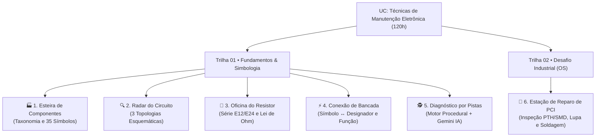

# Documento de Intencionalidade Pedagógica — Arena Eletrônica SENAI (V2.0)

**Autor / Docente Responsável:** [Gabriel Piske](https://piske.online/)  
**Unidade:** SENAI/SC — Timbó  
**Curso:** Aprendizagem Industrial de Eletrônico de Manutenção Industrial (Presencial — 860h)  
**Cód. CONAP:** 488 — Eletricista de Manutenção Eletroeletrônica | **CBO:** 9511-05  
**Unidade Curricular Foco:** Técnicas de Manutenção Eletrônica (Módulo Específico II — 120h: 50h Teoria / 70h Vivência Prática)  

---

## 1. Contextualização e Justificativa Pedagógica

Na **Metodologia SENAI de Educação Profissional (MSEP)**, a prática pedagógica é compreendida como um conjunto integrado de ações didático-pedagógicas que articulam **capacidades técnicas, básicas e socioemocionais** a situações reais e desafiadoras do mundo do trabalho.

Durante a Unidade Curricular de **Técnicas de Manutenção Eletrônica (120h)**, o jovem aprendiz (18 a 24 anos) precisa transitar rapidamente entre a documentação técnica (diagramas esquemáticos, listas de materiais, *datasheets* e simbologias normatizadas IEC/ANSI) e a intervenção física na placa de circuito impresso (inspeção visual, medição com multímetro, soldagem e substituição de componentes PTH e SMD).

A plataforma **Arena Eletrônica SENAI (V2.0)** foi projetada como um **Recurso Didático Digital Gamificado** que atua na **automatização cognitiva do reconhecimento de simbologias, grandezas, portas lógicas e funções básicas de 35 componentes eletrônicos**. Quando o aluno reconhece instantaneamente um símbolo esquemático, sua letra designadora na PCI (`R`, `C`, `L`, `D`, `Q`, `F`, `U`, `K`, `GND`) e sua função primordial, ele reduz a carga cognitiva durante a prática de bancada, diminuindo erros operacionais, curtos-circuitos acidentais e danos a instrumentos de medição.

---

## 2. Alinhamento com o Perfil Profissional de Conclusão (Anexo I do Projeto de Curso)

A plataforma sustenta diretamente o alcance da **Competência Geral do Curso**:
> *"Atuar nos processos de montagem e manutenção dos circuitos eletrônicos de baixa complexidade, considerando a legislação, normas, padrões e requisitos técnicos de qualidade, saúde, segurança e de meio ambiente."*

| Função / Subfunção (Anexo I) | Padrões de Desempenho Atendidos pela Plataforma |
| :--- | :--- |
| **Função 1 — Subfunção: Montar circuitos eletrônicos de baixa complexidade** | • *Considerando o diagrama do circuito eletrônico;* • *Considerando as especificações técnicas dos componentes e insumos contidas em manuais e catálogos do fabricante.* |
| **Função 2 — Subfunção: Manter sistemas eletrônicos** | • *Considerando o projeto e documentações técnicas dos sistemas eletrônicos;* • *Considerando os requisitos da demanda e histórico sobre o funcionamento do sistema eletrônico;* • *Considerando os procedimentos técnicos de manutenção e proteção dos sistemas eletrônicos.* |

---

## 3. Intencionalidade Pedagógica da Arquitetura da Plataforma

Cada tela e mecanismo do sistema foi desenhado com um propósito didático claro dentro do ambiente escolar (Sala de Aula, Laboratório de Informática e Laboratório de Eletrônica):

### 3.1 Acesso Instantâneo por PIN e QR Code (`/`, `/host` e `/play/[pin]`)
* **Intencionalidade Pedagógica:** Eliminar tempos mortos de aula (cadastros longos, senhas esquecidas ou instalações de softwares pesados) e promover **engajamento coletivo imediato**.
* **Conexão com o Projeto de Curso:** Atende aos critérios de *gestão do tempo*, *organização do ambiente de aprendizagem* e uso de *Tecnologias da Informação e Comunicação (TIC)* previstas na matriz curricular.

### 3.2 Painel do Professor com Modos de Tempo Flexíveis, Ranking ao Vivo e Exportação CSV (`/host`)
* **Intencionalidade Pedagógica:** Transformar a revisão teórica em uma **Avaliação Formativa e Diagnóstica em Tempo Real**. Enquanto o telão projeta o desempenho da turma, o docente visualiza instantaneamente o ritmo de acertos, os "curtos-circuitos" (erros conceituais) e o nível de domínio da turma. Ao final, a exportação do relatório em `.CSV` fornece **evidências concretas de aprendizagem** para registro docente e replanejamento pedagógico.
* **Flexibilidade Didática (Execução Isolada e Modos de Tempo de 1m30 a 10 min):** O professor pode rodar **qualquer um dos 5 minigames isoladamente** em **blocos curtos** (`1m30`, `2 min`, `3 min`, `4 min` — ideais para aquecimentos e fechamentos rápidos) ou em **sessões estendidas / maratonas de aprofundamento** (`5 min`, `7 min`, `10 min` — ideais para revisão intensiva, simulados de bancada e oficinas avaliativas). Também pode alternar minigame ou duração diretamente no Lobby ou no Pódio **mantendo o mesmo PIN** e todos os alunos conectados.

### 3.3 Catálogo Normalizado (35 Componentes) e Bancada Solo (`/practice`)
* **Intencionalidade Pedagógica:** Promover a **Aprendizagem Ativa, Autogestão e Acessibilidade Pedagógica**. Antes ou depois da competição ao vivo, o estudante pode consultar o catálogo interativo dos **35 componentes essenciais** (filtrados em *Passivos*, *Semicondutores*, *Proteção & Energia* e *Digital & Portas Lógicas*) e treinar individualmente no seu próprio ritmo com salvamento automático de XP a cada jogatina.

### 3.4 Carreira Técnica, Conquistas e Ranking Multi-Período (`/profile` e `/leaderboard`)
* **Intencionalidade Pedagógica:** Sustentar o **engajamento longitudinal** ao longo de toda a Unidade Curricular (120h). A vinculação opcional da conta Google (ou acesso rápido educacional) acompanha a evolução do aprendiz em **100 Níveis (até 1.000.000 XP)**, **21 Patentes Técnicas** (de *Aprendiz de Bancada* a *Lenda Suprema da Arena SENAI*) e **58 Conquistas** orientadas a precisão, zero curto-circuito, constância e domínio dos 6 módulos. O Ranking Global com filtros **Semanal**, **Mensal** e **Geral** permite ao docente criar metas curtas por turma/semana e incentivar novos alunos a disputarem o topo sem desvantagem histórica.

### 3.5 Disciplina de Precisão: Disjuntor Progressivo e Anti-Autoclique (`PenaltySystem`)
* **Intencionalidade Pedagógica:** Combater o "chute impulsivo" comum em quizzes cronometrados. Na bancada real, clicar ou energizar sem conferir provoca queima de componentes e risco elétrico. Por isso, erros consecutivos acionam bloqueios progressivos de rearme (`2,5s`, `4,0s`, `6,0s`) e penalidades crescentes (`-40`, `-70`, `-110 pts`), enquanto cliques repetitivos abusivos ativam o bloqueio anti-autoclique (`5,0s`, `-90 pts`) — educando o aluno a **ler, analisar e confirmar antes de agir**.

---

## 4. Intencionalidade Pedagógica Detalhada dos 6 Módulos (5 Fundamentos + Estação de Reparo de PCI)

Diferente de quizzes convencionais de múltipla escolha que estimulam apenas a memorização passiva, cada um dos **6 Minigames** propõe uma **mecânica cognitiva e psicomotora distinta**, organizados em **Trilha 01 — Fundamentos & Simbologia** (5 módulos procedurais) e **Trilha 02 — Desafio Industrial por Ordem de Serviço** (`Estação de Reparo de PCI`, com 4 casos curados PTH/SMD), diretamente vinculados às **Capacidades Técnicas** e aos **Conhecimentos** da Unidade Curricular **Técnicas de Manutenção Eletrônica** (Anexo II):

---

### 🏭 Minigame 1: "Esteira de Componentes" (`ConveyorGame`)

* **Dinâmica do Desafio:** Os **35 símbolos eletrônicos** deslocam-se sobre uma esteira industrial com velocidade progressiva. O aluno precisa tomar decisões rápidas para direcionar cada componente ao coletor correto — alternando entre a classificação por **Família Tecnológica** (*Passivos*, *Semicondutores*, *Proteção & Energia* e *Digital & Lógica*) e a identificação direta de **Nome + Letra Designadora na PCI** (`R`, `C`, `L`, `D`, `Q`, `F`, `U`, `K`, etc.), acumulando multiplicador de até `2x`.
* **Intencionalidade Pedagógica (Domínio Cognitivo e Psicomotor):**
  * Simula o ritmo dinâmico da indústria eletroeletrônica (triagem de insumos, preparação de *kits* de montagem/manutenção e conferência de *Bill of Materials — BOM*).
  * Desenvolve o **reconhecimento visual imediato (automatismo)** do símbolo normatizado e sua respectiva letra na serigrafia da placa, evitando trocas acidentais de componentes.
  * O feedback imediato a cada acerto ou acionamento do disjuntor exibe a função e a categoria do componente, transformando o erro em oportunidade instantânea de aprendizagem.
* **Capacidades Técnicas Mobilizadas (Anexo II — Técnicas de Manutenção Eletrônica):**
  * **CT2:** *Identificar componentes eletrônicos;*
  * **CT3:** *Avaliar as características dos componentes eletrônicos;*
  * **CT6:** *Identificar a simbologia de componentes eletrônicos.*
* **Conhecimentos Associados:**
  * *1.1 Características (PTH e SMD);*
  * *2.1 Interpretação de esquemas eletrônicos;*
  * *6.2 Lista de Materiais.*

---

### 🔍 Minigame 2: "Radar do Circuito" (`CircuitRadarGame`)

* **Dinâmica do Desafio:** O aluno inspeciona símbolos inseridos em **3 topologias esquemáticas completas** (12 nós ativos por placa, alternadas automaticamente a cada 3 acertos ou manualmente pelo seletor):
  1. **Topologia A — Fonte Linear Regulada + Sensor Fotoelétrico:** rede AC, fusível `F1`, varistor `RV1`, transformador `T1`, ponte retificadora `BR1`, filtro eletrolítico `C1`, regulador `U1`, `LDR1`, driver `Q1`, relé `K1`, `LED1` e `GND1`.
  2. **Topologia B — Lógica Digital, Isolamento & Alarme Industrial:** fonte DC, chave `SW1`, cristal `Y1`, portas lógicas `AND`, `OR`, `NOT`, `XOR`, display 7 segmentos `DSP1`, optoacoplador `PC1`, `MOSFET Q1`, `Buzzer BZ1` e `GND1`.
  3. **Topologia C — Controle de Potência AC/DC & Condicionamento:** filtro EMI `L1`, desacoplamento `C1`, Schottky `D1`, Zener `ZD1`, termistor `RT1`, potenciômetro `POT1`, Amp-Op `U1`, porta `NAND U2`, tiristores `SCR1`/`TR1`, `R1` e `D2`.
  * As ordens de inspeção alternam entre **Diagnóstico de Falha (sintoma)**, **Função no Estágio** e **Busca por Designador**, com dica técnica opcional (andaime pedagógico).
* **Intencionalidade Pedagógica (Visão Sistêmica e Leitura de Esquemas):**
  * Supera uma das maiores dificuldades dos iniciantes em manutenção: **transitar do símbolo isolado do caderno para a leitura de diagramas esquemáticos analógicos, digitais e de potência**.
  * Estimula a **Visão Sistêmica**: o aluno percebe *onde* cada componente atua dentro do fluxo de energia, sinal e controle.
  * Prepara o aprendiz para a técnica de manutenção por **comparação com o esquema eletrônico** antes de encostar as pontas de prova do multímetro na placa real.
* **Capacidades Técnicas Mobilizadas:**
  * **CT4:** *Aplicar técnicas de localização de defeito;*
  * **CT5:** *Aplicar técnicas de análise de circuitos;*
  * **CT6:** *Identificar a simbologia de componentes eletrônicos;*
  * **CT12:** *Interpretar diagramas esquemáticos eletrônicos.*
* **Conhecimentos Associados:**
  * *2.1 Interpretação de esquemas eletrônicos;*
  * *4.3 Técnicas de localização de defeito: por comparação com esquema eletrônico;*
  * *4.5 Por análise de funcionamento.*

---

### 🎨 Minigame 3: "Oficina do Resistor" (`ResistorBuilderGame`)

* **Dinâmica do Desafio:** Um **gerador procedural da série comercial E12/E24 + Lei de Ohm** cria ordens dinâmicas contextualizadas (126 valores distintos de `10 Ω` a `9,1 MΩ`, com aplicações como *gate-stopper*, limitação de corrente de LED com cálculo em mA, *pull-up* I2C, malha RC com constante $\tau$, *bleeder* de filtro). O aluno **pinta interativamente a 1ª faixa, 2ª faixa e 3ª faixa (multiplicador)** no corpo do resistor e submete a peça à aferição no multímetro virtual.
* **Intencionalidade Pedagógica (Aprender Fazendo / *Learning by Doing*):**
  * Inverte o processo mental tradicional: em vez de apenas decodificar cores prontas, o aluno **constrói o código de cores** a partir da especificação técnica em Ohms ($\Omega$, $\text{k}\Omega$, $\text{M}\Omega$).
  * Contextualiza cada valor ôhmico com uma **aplicação prática real de manutenção/montagem**.
  * Possui andaime pedagógico (*scaffolding*): o aluno pode consultar a tabela de cores na tela (`55 pts`) até ganhar autonomia para construir sem consulta (`110 pts`).
* **Capacidades Técnicas Mobilizadas:**
  * **CT2:** *Identificar componentes eletrônicos;*
  * **CT3:** *Avaliar as características dos componentes eletrônicos;*
  * **CT8:** *Interpretar tabelas, manuais, data-sheets etc.;*
  * **CT11:** *Realizar medições em componentes eletrônicos básicos;*
  * **CT13:** *Substituir componentes defeituosos.*
* **Conhecimentos Associados:**
  * *3.1 Instrumentos de medição e de bancada: Multímetro;*
  * *4.2 Teste de resistência ôhmica;*
  * *6.1 Dados técnicos em catálogos e datasheets / 6.2 Lista de Materiais.*

---

### ⚡ Minigame 4: "Conexão de Bancada" (`BenchMatchGame`)

* **Dinâmica do Desafio:** Um painel interativo apresenta 6 símbolos esquemáticos de um lado e 6 especificações técnicas do outro (alternando entre função básica e pistas técnicas conforme o nível da placa, sorteados entre os **35 componentes**). O aluno fecha os 6 pares (`+50 pts` por par e `+120 pts` ao concluir a placa) para avançar continuamente pelos níveis (*Placa Nível 1, Nível 2, Nível 3...*).
* **Intencionalidade Pedagógica (Consolidação Conceitual e Memória de Trabalho):**
  * Promove a **tríade de domínio fundamental da manutenção eletrônica**:
    $$\text{Símbolo Gráfico} \longleftrightarrow \text{Designador na Placa (R, C, D, Q, F, U, K)} \longleftrightarrow \text{Função Física no Circuito}$$
  * Trabalha a atenção concentrada e a precisão sob tempo: conectar um par incorreto aciona o disjuntor progressivo, educando o aluno a **conferir antes de conectar/energizar** — hábito essencial de segurança e qualidade na manutenção industrial.
* **Capacidades Técnicas Mobilizadas:**
  * **CT2:** *Identificar componentes eletrônicos;*
  * **CT3:** *Avaliar as características dos componentes eletrônicos;*
  * **CT5:** *Aplicar técnicas de análise de circuitos;*
  * **CT6:** *Identificar a simbologia de componentes eletrônicos;*
  * **CT12:** *Interpretar diagramas esquemáticos eletrônicos.*
* **Conhecimentos Associados:**
  * *2.1 Interpretação de esquemas eletrônicos;*
  * *4.6 Inspeção visual;*
  * *6.1 Especificação técnica de fabricantes.*

---

### 🕵️ Minigame 5: "Diagnóstico por Pistas" (`SmokeDetectiveGame`)

* **Dinâmica do Desafio:** Um símbolo eletrônico inicia desfocado (`35%` de foco óptico) e ganha nitidez em 3 estágios enquanto **3 pistas técnicas progressivas** são reveladas (pista 1 valendo `120 pts`, pista 2 valendo `80 pts`, pista 3 valendo `45 pts`). O aluno analisa as evidências (letra na placa, unidade de medida, polaridade, comportamento no multímetro, tabelas-verdade ou riscos de queima) e identifica a peça entre 6 candidatos (com distratores priorizados da mesma família tecnológica). Combina o **Motor Procedural V2** com geração opcional de laudos inéditos via **IA Gemini**.
* **Intencionalidade Pedagógica (Raciocínio Hipotético-Dedutivo e Investigação de Defeitos):**
  * Desenvolve diretamente a **Postura Investigativa** exigida no diagnóstico de defeitos reais: na manutenção industrial, o defeito raramente é óbvio à primeira vista; o técnico coleta sintomas ("pistas"), cruza com o comportamento físico dos componentes e formula uma hipótese certeira.
  * Reforça conceitos críticos de bancada e segurança embutidos nas pistas (ex.: *capacitores eletrolíticos que estufam com polaridade invertida*, *teste de continuidade sonora/BIP em fusíveis*, *posicionamento da ponta preta do multímetro no GND*, *queda de tensão direta em diodos de silício e Schottky*).
* **Capacidades Técnicas Mobilizadas:**
  * **CT3:** *Avaliar as características dos componentes eletrônicos;*
  * **CT4:** *Aplicar técnicas de localização de defeito;*
  * **CT9:** *Aplicar normas de saúde e segurança no trabalho;*
  * **CT10:** *Utilizar instrumentos de medidas elétricas;*
  * **CT11:** *Realizar medições em componentes eletrônicos básicos.*
* **Conhecimentos Associados:**
  * *3.1 Multímetro;*
  * *4.1 Teste de continuidade / 4.5 Por análise de funcionamento / 4.6 Inspeção visual;*
  * *5.1 Normas de segurança aplicáveis à manutenção de sistemas elétricos.*

---

### 🔧 Minigame 6 (OS Industrial): "Estação de Reparo de PCI" (`IndustrialRepairGame`)

* **Dinâmica do Desafio:** Em formato de **Ordem de Serviço Industrial** (`OS-SOL-01` a `OS-SOL-04`), o aluno avalia uma placa retirada de campo (montagem **PTH** ou **SMD**), utiliza **zoom, arraste e lupa óptica virtual** para inspecionar hotspots, localiza defeitos físicos reais (*solda trincada, ponte de solda SMD, polaridade invertida de diodo, resistor SMD deslocado*), define o procedimento seguro de bancada, valida critérios finais de qualidade e analisa a **comparação visual Antes × Depois**.
* **Intencionalidade Pedagógica:** Desenvolve critério de inspeção visual, disciplina de segurança ESD/desenergização e tomada de decisão em retrabalho PTH e SMD, rejeitando práticas destrutivas ou improvisos inseguros.
* **Capacidades Técnicas Mobilizadas:** **CT2**, **CT3**, **CT4** (*inspeção visual*), **CT9** (*segurança na bancada*), **CT13** (*substituição e soldagem/dessoldagem*).

---

## 5. Desenvolvimento das Capacidades Socioemocionais e Eixos da BNCC

Conforme estabelecido no **Projeto de Curso SENAI/SC**, a formação do aprendiz integra capacidades socioemocionais e os Eixos Estruturantes da BNCC. A dinâmica da **Arena Eletrônica SENAI** trabalha essas dimensões de forma orgânica:

| Competência Socioemocional / Eixo BNCC (Projeto de Curso) | Como a Plataforma Desenvolve na Prática |
| :--- | :--- |
| **Aprendizagem Ativa e Estratégias de Aprendizagem** | O aluno deixa de ser ouvinte passivo e assume protagonismo ativo, utilizando o feedback imediato, o catálogo de 35 peças e as conquistas para autorregular seu aprendizado. |
| **Criatividade, Originalidade, Iniciativa e Autogestão** | Na gestão do tempo em sessões curtas (1m30–4m) ou estendidas (5m–10m), no uso estratégico de dicas e no estudo autônomo pelo modo *Catálogo & Treino Solo* (`/practice`). |
| **Inteligência Emocional, Autocontrole e Autorregulação** | Ao lidar com a pressão saudável do cronômetro e manter a calma e a precisão diante do *disjuntor progressivo* (evitando cliques impulsivos que acionam o anti-autoclique). |
| **Pensamento Crítico e Resolução de Problemas Complexos** | Nos minigames *Radar do Circuito* (3 topologias) e *Diagnóstico por Pistas*, onde o aluno cruza função, estágio elétrico, lógica booleana e sintomas de falha antes de agir. |
| **Eixo BNCC: Investigação Científica** | Exercitado na formulação rápida de hipóteses diagnósticas no *Diagnóstico por Pistas* e na localização de nós defeituosos no *Radar do Circuito*. |
| **Eixo BNCC: Mediação e Intervenção Sociocultural** | No clima de competição saudável, respeito às regras, socialização de estratégias no *debriefing* e acompanhamento coletivo no Ranking Semanal/Mensal. |

---

## 6. Matriz Sintética de Rastreabilidade Pedagógica (UC: Técnicas de Manutenção Eletrônica)

| Capacidade Técnica da UC (Matriz SENAI) | 🏭 MG1: Esteira | 🔍 MG2: Radar | 🎨 MG3: Resistor | ⚡ MG4: Conexão | 🕵️ MG5: Diagnóstico | 🔧 MG6: Reparo PCI | 📖 Guia (`/practice`) |
| :--- | :---: | :---: | :---: | :---: | :---: | :---: | :---: |
| **Identificar componentes eletrônicos** | ✅ | ✅ | ✅ | ✅ | ✅ | ✅ | ✅ |
| **Identificar a simbologia de componentes eletrônicos** | ✅ | ✅ | — | ✅ | ✅ | — | ✅ |
| **Avaliar as características dos componentes eletrônicos** | ✅ | — | ✅ | ✅ | ✅ | ✅ | ✅ |
| **Interpretar diagramas esquemáticos eletrônicos** | — | ✅ | — | ✅ | — | — | ✅ |
| **Aplicar técnicas de análise de circuitos** | — | ✅ | — | ✅ | ✅ | ✅ | — |
| **Aplicar técnicas de localização de defeito** | — | ✅ | — | — | ✅ | ✅ | — |
| **Interpretar tabelas, manuais, códigos e listas (BOM)** | ✅ | — | ✅ | ✅ | — | ✅ | ✅ |
| **Utilizar instrumentos e realizar medições básicas** | — | — | ✅ | — | ✅ | ✅ | — |
| **Substituir componentes defeituosos (equivalência/valores)** | — | — | ✅ | — | — | ✅ | — |
| **Aplicar normas de saúde e segurança na bancada** | — | ✅ | — | — | ✅ | ✅ | — |

---

## 7. Sugestão de Roteiro Metodológico para Uso em Sala de Aula / Laboratório

Para potencializar os resultados pedagógicos dentro das **120h da UC**, recomenda-se o seguinte protocolo de aplicação pelo docente aproveitando os modos de tempo curtos e estendidos:

1. **Aquecimento / Avaliação Diagnóstica (`1m30` a `3 min` no início da aula):**
   * Projetar o `/host` com a **Esteira de Componentes** ou **Conexão de Bancada** em rodada rápida de `2 min` para ativar a memória prévia da turma antes da explicação ou prática na bancada.
2. **Transição Teoria $\rightarrow$ Prática de Bancada (`3 min` a `5 min` antes do laboratório):**
   * Sem trocar o PIN da sala, alternar para o **Radar do Circuito** e a **Oficina do Resistor** (`4 min` ou `5 min`) imediatamente antes de entregar placas, componentes e multímetros aos alunos, garantindo leitura segura do esquema e das faixas de resistores.
3. **Maratona de Revisão / Simulado Formativo (`7 min` ou `10 min` em aulas de consolidação):**
   * Utilizar os modos estendidos de **`7 min`** ou **`10 min`** no **Diagnóstico por Pistas** ou **Radar do Circuito** para avaliar consistência sob fôlego longo, baixar o relatório `.CSV` da turma no Pódio Final, revisar os erros recorrentes em *debriefing* coletivo e acompanhar o avanço semanal dos aprendizes no **Ranking Global**.
